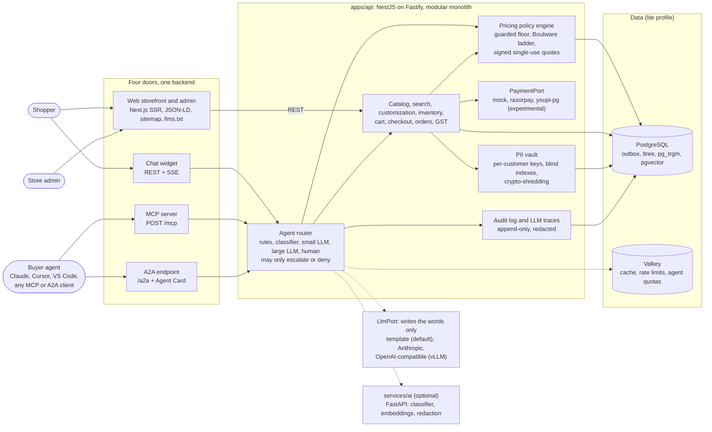

# Architecture

AgentBazaar is one backend with four doors: a server-rendered web storefront, an MCP server, an A2A endpoint and a chat widget. All four call the same services and the same pricing policy engine. The core is a NestJS-on-Fastify modular monolith ([ADR 0001](adr/0001-modular-monolith.md)); every external dependency sits behind a port, and a profile (`lite`, `growth`, `scale`) chooses the adapters ([profiles](profiles.md)).

<!-- diagram:architecture -->

<!-- /diagram:architecture -->

## Repository layout

```text
apps/
  api/          NestJS + Fastify modular monolith: REST, MCP, A2A, chat
  web/          Next.js storefront and admin console
  demo/         `pnpm demo`: embedded store, scripted buyer agent, transcript
services/
  ai/           Optional FastAPI service: classifier, embeddings, PII redaction
packages/
  contracts/    Zod schemas; generated OpenAPI and AI-service JSON Schemas
  config/       Profile loader with fail-fast validation
  testkit/      Deterministic synthetic catalog, scripted and adversarial buyers
deploy/
  compose/      Docker Compose profiles, Caddyfile, Prometheus config
  helm/         Helm chart with growth and scale values
  terraform/    OpenTofu/Terraform modules and per-profile root modules for AWS
tests/load/     k6 load profiles
docs/           This documentation, ADRs, runbooks, compliance pack, diagrams
```

## Inside a request

1. **Edge.** Caddy terminates TLS, adds security headers, limits request bodies to 1 MB and answers 404 for `/metrics`.
2. **Fastify.** Each request gets an id (a caller's `x-request-id` is accepted only if well-formed, so it cannot inject into logs), Helmet sets a strict CSP, a global rate limit applies per IP, and bodies are capped at 256 KB. The raw body is kept for webhook signature checks.
3. **Auth guard.** The bearer token (built-in EdDSA issuer or OIDC) becomes a principal: anonymous, customer or agent, with scopes. The route's requirement (`public`, `optional`, `customer`, `admin`, or a scope) is checked, admin routes demand an MFA-verified session, and agents are held to their per-minute quota.
4. **Validation.** Every body, query and path parameter is parsed with the Zod schema from `packages/contracts`, the same schema that generates the OpenAPI document and the MCP tool definitions.
5. **Use case.** The controller calls an application service, which runs the module's pure domain rules and writes through parameterised SQL, in one transaction per use case. Changes that others care about append an outbox event in that same transaction.
6. **Response.** Errors are mapped to a stable `{ error: { code, message, requestId } }` body without internals. Latency is recorded per route pattern (never the raw URL, which can carry checkout tokens).

## Modules and the data they own

Modules never read each other's tables; they call a public service or react to an event.

| Module | Owns | Notes |
| --- | --- | --- |
| catalog | `brands`, `categories` (`ltree`), `attribute_schemas`, `products`, `variants`, `price_history`, `competitor_snapshots` | Variants hold price, MRP, cost and landed-cost components; a check constraint keeps price at or below MRP |
| search | `search_documents` | Read model fed from the outbox, rebuilt by `cli reindex` |
| customization | `customization_schemas`, `designs`, `design_allowed_on`, `customization_reviews` | Text and catalog designs only, no uploads |
| pricing | `discount_policies`, `negotiation_sessions`, `offers`, `quotes`, `pricing_approvals` | `offers` is append-only; one active quote per negotiation |
| inventory | `stock_levels`, `reservations` | `reserved <= on_hand` is a database constraint |
| orders (cart, checkout, returns) | `carts`, `cart_lines`, `checkout_sessions`, `orders`, `order_lines`, `order_line_customizations`, `order_events`, `return_requests` | `order_events` is append-only |
| payments | `payments`, `refunds`, `webhook_events` | Webhooks deduplicated by `(provider, event_id)` |
| tax | `gst_rates`, `invoice_counters`, `invoices` | Rates per HSN code with effective dates |
| recommendations | `product_edges` | `compatible_with`, `bought_together`, `alternative_of` |
| identity | `users`, `refresh_tokens`, `agent_clients` | Users hold a blind index of the email, never the email |
| pii | `pii.customers`, `pii.addresses`, `pii.consents`, `pii.erasure_requests` | Separate schema, field-level encryption |
| audit | `audit_log`, `llm_traces` | Append-only, redacted |
| agent | `chat_sessions`, `chat_messages`, `handoffs` | Compact structured state instead of full transcripts |
| analytics | `analytics_events` | Searches, zero-result searches, AI-crawler hits, AI referrals |
| shared | `outbox_events`, `processed_events`, `idempotency_keys`, `schema_migrations` | Infrastructure tables |

Append-only tables (`offers`, `order_events`, `audit_log`, `llm_traces`) have a trigger that raises an error on any `UPDATE` or `DELETE`.

## Money, tax and stock

- **Money is integer paise** with an `INR` currency everywhere; one amount is at most ₹1 crore. Agent-facing inputs accept rupees and are converted exactly with `rupeesToPaise()`. A2A carries amounts as decimal strings.
- **GST** splits a tax-inclusive line total into taxable value and tax so the parts always add up to the exact total: CGST and SGST halves within the seller's state, IGST across states. Invoice numbers are gap-free per Indian financial year. The seeded rates are illustrative.
- **Stock** is reserved by a single conditional update that fails when stock is short, rows are locked in a fixed order to avoid deadlocks between multi-line checkouts, and reservations expire. Shown quantities are capped at 50 so exact stock is not leaked.

## State machines

- **Negotiation:** `inquiry`, `quote`, `counter`, `pending_approval`, `accepted`, `rejected`, `expired`, `checkout`, with explicit legal transitions (see the [README](../README.md#how-negotiation-works)).
- **Order:** `pending_payment`, `payment_observed`, `paid`, `cod_confirmed`, `shipped`, `delivered`, `return_requested`, `returned`, `refunded`, `cancelled`, `payment_failed`, `expired`, each change written to `order_events`.
- **Payment:** `created`, `observed`, `captured`, `reconciled`, `failed`, `refund_pending`, `refunded`, `cod_pending`, `cod_collected`. A webhook is applied only if it moves the payment forward, so replayed and out-of-order events change nothing.

## Events

Writes append to `outbox_events` in the same transaction; the relay delivers them to the event bus (in-process in lite, NATS in growth, Kafka in scale) and each consumer records `(consumer, event_id)` so it acts once ([ADR 0003](adr/0003-outbox-and-event-bus.md)). Examples: `catalog.product_upserted` and `inventory.stock_changed` (search indexing), `negotiation.closed` (analytics), `payment.status_changed` and `payment.refund_updated` (orders), `pii.customer_erased`. Periodic jobs (expiry sweeps, retention) run under per-job advisory locks.

## Search

Lite search runs inside PostgreSQL: weighted full-text search (name and brand first, then SKU and category, then description), trigram similarity for typos, and a 256-dimension vector search over an HNSW index, fused with reciprocal rank fusion (k = 60). The default embeddings are deterministic feature hashes, identical in TypeScript and Python; the AI service can supply a sentence-transformers model instead. Growth and scale swap the engine behind `SearchPort` and backfill it from the catalog.

## The agent layer

The router assigns each chat or agent turn to a tier, from rules and cache (0) to a person (4), and can only raise the tier or deny. The pricing engine decides every number; a model may only rephrase the template reply, and an output guard replaces any reply that contains an invented number, a link, contact details, personal data or talk of floors and margins. See [agents.md](agent-integration.md) and [ADR 0005](adr/0005-llm-writes-words-only.md).

## Personal data

Personal data lives only in the `pii` schema. Each customer has a random data key wrapped by the master key (or by OpenBao Transit in growth and scale); every field is encrypted with AES-256-GCM, with the customer and field name bound in as associated data. Email and phone lookups use HMAC blind indexes. Other modules hold opaque tokens (`cus_…`, `adr_…`). Erasure deletes the wrapped key and every encrypted field. Free text that is logged, traced or stored in transcripts is redacted first (emails, card numbers that pass a Luhn check, Aadhaar, phone, PAN, UPI IDs, PIN codes). See the [data map](compliance/data-map.md) and the [threat model](security/threat-model.md).

## Product graph

`product_edges` holds fixed-hop relations between products. On PostgreSQL 19, a SQL/PGQ property graph can be created over the table; on older versions, including today's Compose image (`pgvector/pgvector:pg18`) and managed services that lag behind, the same queries run as plain joins. The category tree stays in `ltree`, because the first version of SQL/PGQ has no variable-length paths.

## Observability and resilience

- Structured JSON logs (pino) with request ids and PII redaction.
- Prometheus metrics at `/metrics` (not exposed by the edge): request latency per route, negotiation decisions, LLM tokens, router tiers, outbox backlog and orders ([ADR 0008](adr/0008-prometheus-io-client.md)). `/healthz` for liveness and `/readyz` for database reachability and outbox lag.
- Calls to payment gateways, OpenBao and LLM providers have timeouts and circuit breakers; LLM failures fall back to template replies.
- Order, payment and agent tool calls are idempotent: checkout and order creation take an `Idempotency-Key`, webhooks are deduplicated by event id, and quotes are single-use.
